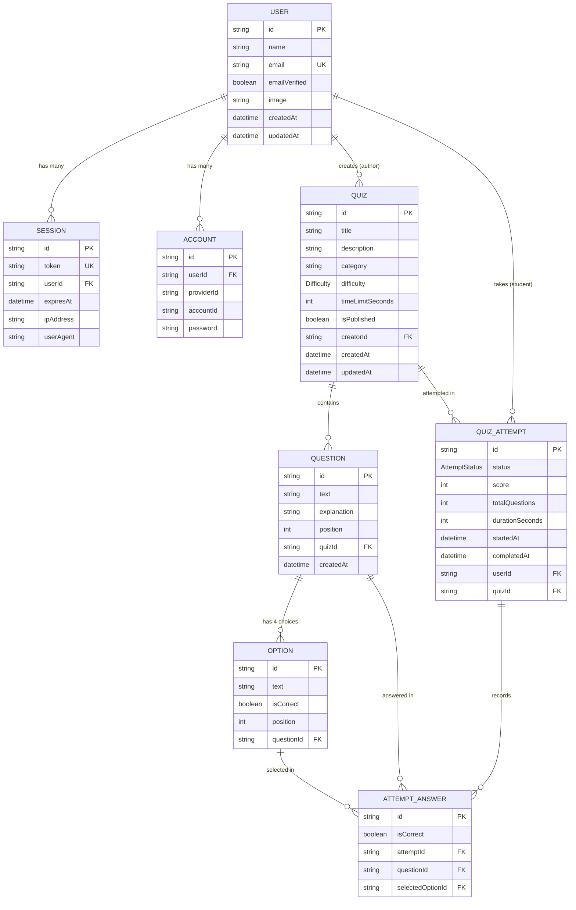
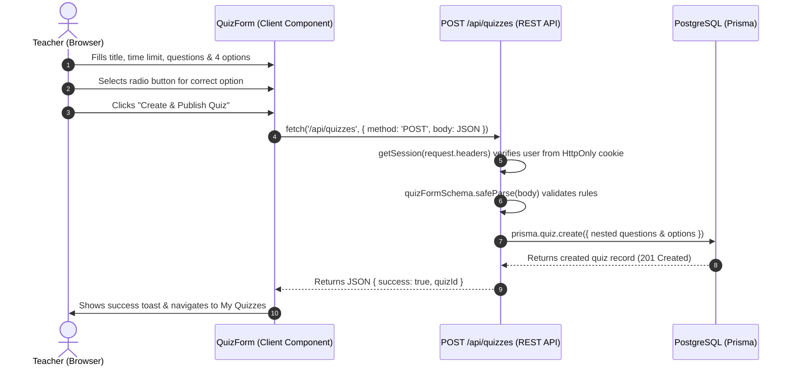
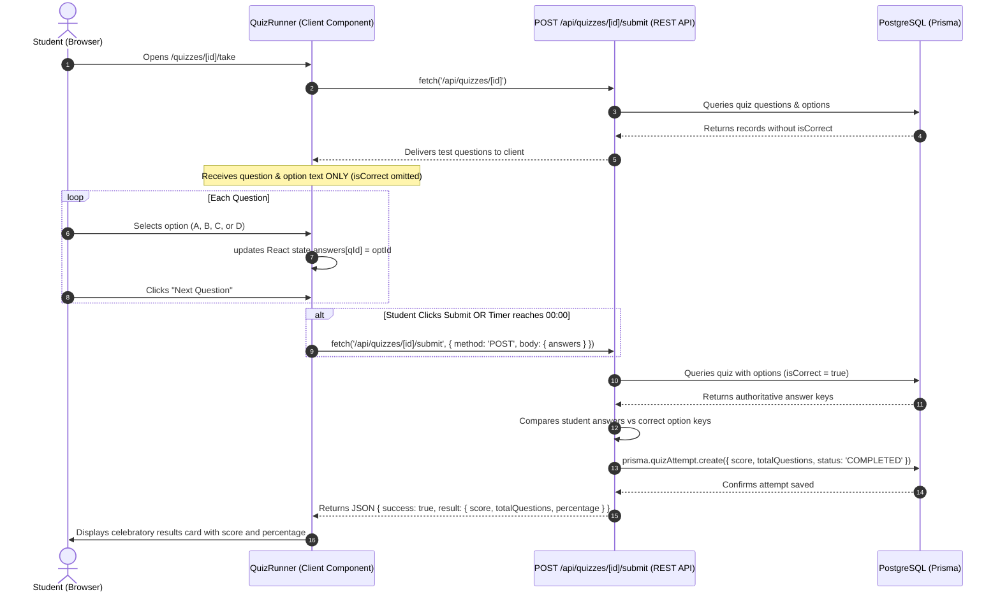
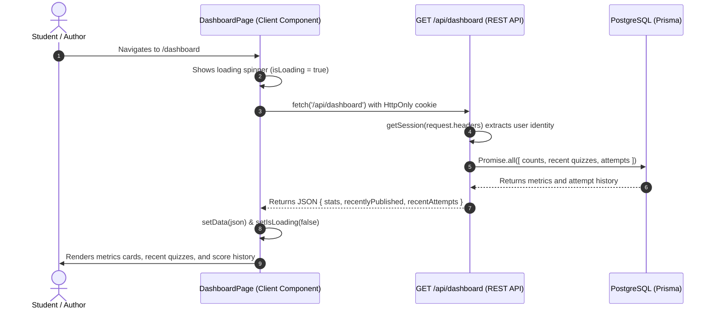

# QuizForge — Comprehensive System Documentation & Technical Viva Guide

## 1. Project Overview

**QuizForge** is an interactive, full-stack quiz authoring, discovery, and assessment web application designed for computer science students and educators. It enables instructors to author structured quizzes with custom time limits, multiple-choice options, and difficulty levels, while providing students with a timed, distraction-free environment to take assessments and receive immediate, authoritative performance evaluation.

### Technology Stack

| Layer | Technology | Version | Purpose |
|---|---|---|---|
| **Frontend UI** | Next.js & React (Client Components) | 16.4.2 / 19.3.0 | Client-side interactive components, form management, dynamic state (`useState`, `useEffect`) |
| **REST API Layer** | Next.js Route Handlers (`/api`) | 16.4.2 | RESTful HTTP endpoints (`GET`, `POST`, `PUT`, `DELETE`), JSON request/response handling |
| **Language** | TypeScript | 5.x | End-to-end static typing, compile-time safety, strict interfaces |
| **Database** | PostgreSQL | 18 | Relational data persistence, foreign key integrity, indexes |
| **ORM** | Prisma ORM | 7.10.1 with `@prisma/adapter-pg` | Type-safe database queries, schema migrations, client generation |
| **Authentication** | Better Auth | 1.7.10 | Credential-based authentication, HttpOnly signed session cookies |
| **Styling** | Tailwind CSS & shadcn/ui | 4.x / 4.22.0 | Utility-first responsive styling, accessible UI primitives |
| **Validation** | Zod | 4.x / 3.x | Schema-based payload validation for API requests and forms |

---

## 2. System Architecture & Design Philosophy

QuizForge is architected around a classic, robust 3-tier **Client → REST API (`/api`) → Database** model. Rather than using React Server Component (RSC) direct database calls or Next.js Server Actions, all server operations are exposed through standard REST API route handlers (`/api/...`). The frontend communicates with the backend exclusively via asynchronous HTTP requests (`GET`, `POST`, `PUT`, `DELETE`) with JSON bodies.

```
+---------------------------------------------------------------------------------------+
|                                QUIZFORGE ARCHITECTURE                                 |
+---------------------------------------------------------------------------------------+

  CLIENT LAYER (Browser / React 19 Client Components)
  ├── Interactive Pages ('use client' using useState, useEffect, fetch):
  │   ├── app/quizzes/page.tsx               -> fetch('/api/quizzes?...')
  │   ├── app/quizzes/[id]/page.tsx          -> fetch('/api/quizzes/[id]')
  │   ├── app/quizzes/[id]/take/page.tsx     -> fetch('/api/quizzes/[id]')
  │   ├── app/(dashboard)/dashboard/page.tsx -> fetch('/api/dashboard')
  │   └── app/(dashboard)/.../my-quizzes/    -> fetch('/api/quizzes?mine=true')
  ├── Form & Assessment Runners:
  │   ├── components/quiz-form/quiz-form.tsx -> POST / PUT /api/quizzes
  │   └── components/quiz-runner/quiz-runner.tsx -> POST /api/quizzes/[id]/submit
  └── Browser Session: Secure HttpOnly cookie automatically attached by the browser
            │
            │ HTTP Request (GET, POST, PUT, DELETE with application/json)
            ▼
  REST API LAYER (Next.js App Router Route Handlers at /api)
  ├── /api/quizzes             -> GET (catalog & search, or ?mine=true), POST (create quiz)
  ├── /api/quizzes/[id]        -> GET (details), PUT (update), DELETE (delete)
  ├── /api/quizzes/[id]/submit -> POST (authoritative score evaluation)
  ├── /api/dashboard           -> GET (metrics & attempt history)
  ├── /api/auth/[...all]       -> Better Auth authentication endpoints
  ├── Session Guard: getSession(request.headers) extracts user identity from cookies
  └── Payload Validator: Zod (quizFormSchema) verifies request body structure
            │
            │ Type-safe SQL Queries via Driver Adapter
            ▼
  DATABASE LAYER (PostgreSQL & Prisma ORM)
  ├── Prisma Client Singleton (@/lib/prisma)
  ├── Relational Models: User, Session, Quiz, Question, Option, QuizAttempt
  └── Atomic Transactions: prisma.$transaction for cascades and score persistence
```

### Key Architectural Decisions:
1. **Decoupled REST API (`/api`):** Every mutation and data query can be called via standard HTTP, making the backend completely testable using Postman, cURL, or any frontend client.
2. **Authoritative Server-Side Scoring:** Answer keys (`isCorrect`) are **never returned by `GET /api/quizzes/[id]`** for test-takers. The client only receives question and option text. The authoritative score is computed strictly on the server when the student submits answers to `POST /api/quizzes/[id]/submit`.
3. **Session-Cookie Security:** Rather than storing JWTs in `localStorage` (which is vulnerable to XSS attacks), Better Auth issues an `HttpOnly` cookie that the browser automatically attaches to all `/api` requests.
4. **Predictable Component Lifecycle:** In the viva, explaining client components with `useState`, `useEffect`, and `fetch('/api/...')` is the canonical React pattern that professors and viva examiners expect in Web Technology and Full-Stack courses.

---

## 3. Database Architecture & ER Model

The QuizForge database is built on PostgreSQL and managed via Prisma ORM. It contains 8 relational models partitioned into **Authentication Entities** and **Assessment Domain Entities**.

### 3.1 Entity Relationship Diagram (ERD)



---

### 3.2 Schema Specifications & Constraints

#### 1. `user` (Better Auth User Entity)
- **Primary Key:** `id` (`String` @default(uuid()))
- **Unique Columns:** `email` (`String`)
- **Relationships:**
  - `quizzes`: Quizzes authored by this user (`1 : N`)
  - `attempts`: Quiz attempts taken by this user (`1 : N`)
  - `sessions`: Active login sessions (`1 : N`)

#### 2. `quizzes` (Assessment Container)
- **Primary Key:** `id` (`String` @default(uuid()))
- **Foreign Key:** `creatorId` references `user(id)` with `onDelete: Cascade`
- **Attributes:** `title`, `description`, `category`, `difficulty`, `timeLimitSeconds`, `isPublished`, `createdAt`, `updatedAt`
- **Relationships:**
  - `questions`: Questions belonging to this quiz (`1 : N`, Cascade)
  - `attempts`: Historical attempts by students (`1 : N`, Restrict)

#### 3. `questions` (Quiz Items)
- **Primary Key:** `id` (`String` @default(uuid()))
- **Foreign Key:** `quizId` references `quizzes(id)` with `onDelete: Cascade`
- **Constraints:** `@@unique([quizId, position])` enforces consistent question ordering without gaps or duplicates.
- **Attributes:** `text` (question prompt), `position` (integer ordering).

#### 4. `options` (Multiple-Choice Choices)
- **Primary Key:** `id` (`String` @default(uuid()))
- **Foreign Key:** `questionId` references `questions(id)` with `onDelete: Cascade`
- **Constraints:** `@@unique([questionId, position])` ensures positions 1 to 4 are unique per question.
- **Attributes:**
  - `text`: Choice text
  - `isCorrect`: Boolean (`true` for the single correct answer, `false` for distractors)
  - `position`: 1, 2, 3, or 4 (mapped to UI letters A, B, C, D)

#### 5. `quiz_attempts` (Assessment Records)
- **Primary Key:** `id` (`String` @default(uuid()))
- **Foreign Keys:**
  - `userId` references `user(id)` with `onDelete: Cascade`
  - `quizId` references `quizzes(id)` with `onDelete: Restrict`
- **Attributes:**
  - `status`: Enum (`IN_PROGRESS`, `COMPLETED`, `EXPIRED`)
  - `score`: Total number of questions answered correctly
  - `totalQuestions`: Total questions in the quiz
  - `completedAt`: Timestamp when submission occurred

---

## 4. REST API Endpoints & Feature Implementation

The backend exposes a clean REST API under `/api`. Below are the endpoint definitions, request/response formats, and code implementations.

### REST API Route Reference

| Method | Endpoint | Access | Purpose |
|---|---|---|---|
| `GET` | `/api/quizzes?q=...&category=...` | Public | List published quizzes with title, category, and difficulty filters |
| `GET` | `/api/quizzes?mine=true` | Protected | List all quizzes authored by the logged-in user |
| `POST` | `/api/quizzes` | Protected | Create a new quiz with nested questions and options |
| `GET` | `/api/quizzes/[id]` | Public | Fetch quiz details and questions (omitting answer keys) |
| `GET` | `/api/quizzes/[id]?forEdit=true` | Protected (Owner) | Fetch full quiz details including answer keys for author editing |
| `PUT` | `/api/quizzes/[id]` | Protected (Owner) | Update an existing quiz, questions, and options |
| `DELETE` | `/api/quizzes/[id]` | Protected (Owner) | Delete a quiz and its questions, options, and attempts |
| `POST` | `/api/quizzes/[id]/submit` | Protected | Submit answers, calculate score, record attempt |
| `GET` | `/api/dashboard` | Protected | Fetch student overview metrics, recent tests, and attempt history |
| `ALL` | `/api/auth/[...all]` | Public | Better Auth endpoints (sign-in, sign-up, sign-out) |

---

### Feature 1: Authentication & Session Protection

#### Concept & Workflow
1. The student submits email and password on `/login` or `/register` via `authClient.signIn.email()` or `authClient.signUp.email()`.
2. Better Auth validates credentials against PostgreSQL and sets an encrypted `HttpOnly` session cookie.
3. Protected REST API routes call `getSession(request.headers)` to read incoming HTTP request headers and extract the authenticated user's ID securely without exposing tokens to client JavaScript.

#### Code: Server-Side Session Helper (`lib/auth-server.ts`)
```typescript
import { headers } from 'next/headers';
import { auth } from '@/lib/auth';

export async function getSession(reqHeaders?: Headers) {
  try {
    const session = await auth.api.getSession({
      headers: reqHeaders || (await headers()),
    });
    return session;
  } catch {
    return null;
  }
}
```

---

### Feature 2: Quiz Catalog & Search (`GET /api/quizzes`)

#### Concept & Workflow
- The client component sends an HTTP GET request to `/api/quizzes?q=...&category=...&difficulty=...`.
- If `?mine=true` is passed, the endpoint returns all quizzes authored by the authenticated creator.
- For catalog queries, the route handler queries PostgreSQL with case-insensitive filters and returns quizzes along with distinct categories.

#### Code: API Route Handler (`app/api/quizzes/route.ts`)
```typescript
import { NextRequest, NextResponse } from 'next/server';
import prisma from '@/lib/prisma';
import { getSession } from '@/lib/auth-server';

export async function GET(request: NextRequest) {
  try {
    const { searchParams } = new URL(request.url);
    const mine = searchParams.get('mine') === 'true';

    // 1. Author's own quizzes
    if (mine) {
      const session = await getSession(request.headers);
      if (!session?.user) {
        return NextResponse.json({ error: 'Unauthorized' }, { status: 401 });
      }

      const quizzes = await prisma.quiz.findMany({
        where: { creatorId: session.user.id },
        orderBy: { updatedAt: 'desc' },
        select: {
          id: true,
          title: true,
          description: true,
          category: true,
          difficulty: true,
          timeLimitSeconds: true,
          isPublished: true,
          createdAt: true,
          updatedAt: true,
          _count: { select: { questions: true, attempts: true } },
        },
      });

      return NextResponse.json({ quizzes });
    }

    // 2. Public catalog with filters
    const q = searchParams.get('q')?.trim();
    const category = searchParams.get('category')?.trim();
    const difficulty = searchParams.get('difficulty')?.trim();

    const whereClause: any = { isPublished: true };
    if (q) whereClause.title = { contains: q, mode: 'insensitive' };
    if (category && category !== 'all') whereClause.category = { equals: category, mode: 'insensitive' };
    if (difficulty && difficulty !== 'all') whereClause.difficulty = difficulty.toUpperCase();

    const [quizzes, totalCount, distinctCategories] = await Promise.all([
      prisma.quiz.findMany({
        where: whereClause,
        orderBy: { createdAt: 'desc' },
        select: {
          id: true,
          title: true,
          description: true,
          category: true,
          difficulty: true,
          timeLimitSeconds: true,
          createdAt: true,
          creator: { select: { name: true } },
          _count: { select: { questions: true, attempts: true } },
        },
      }),
      prisma.quiz.count({ where: whereClause }),
      prisma.quiz.findMany({
        where: { isPublished: true },
        select: { category: true },
        distinct: ['category'],
      }),
    ]);

    return NextResponse.json({
      quizzes,
      totalCount,
      categories: distinctCategories.map((c) => c.category),
    });
  } catch (error) {
    return NextResponse.json({ error: 'Failed to fetch quizzes.' }, { status: 500 });
  }
}
```

#### Code: Client Fetching (`app/quizzes/page.tsx`)
```typescript
'use client';

useEffect(() => {
  async function loadQuizzes() {
    setIsLoading(true);
    const query = new URLSearchParams();
    if (q) query.set('q', q);
    if (category !== 'all') query.set('category', category);
    if (difficulty !== 'all') query.set('difficulty', difficulty);

    const res = await fetch(`/api/quizzes?${query.toString()}`);
    const data = await res.json();
    setQuizzes(data.quizzes || []);
    setTotalCount(data.totalCount || 0);
    setIsLoading(false);
  }
  loadQuizzes();
}, [q, category, difficulty]);
```

---

### Feature 3: Quiz Authoring (`POST /api/quizzes`, `PUT`, `DELETE /api/quizzes/[id]`)

#### Concept & Workflow
- **Creating a Quiz (`POST /api/quizzes`):** The client sends a JSON payload with title, category, difficulty, time limit, and questions (each with 4 options and an `isCorrect` flag). The server validates the payload with Zod and creates the records atomically.
- **Editing a Quiz (`PUT /api/quizzes/[id]`):** Verifies the logged-in user is the creator, deletes existing questions, and recreates the updated questions and options in an atomic transaction.
- **Deleting a Quiz (`DELETE /api/quizzes/[id]`):** Verifies ownership and deletes the quiz along with all attempts.

#### Code: Create Quiz Endpoint (`app/api/quizzes/route.ts`)
```typescript
export async function POST(request: NextRequest) {
  const session = await getSession(request.headers);
  if (!session?.user) {
    return NextResponse.json({ error: 'Unauthorized' }, { status: 401 });
  }

  const body = await request.json();
  const validation = quizFormSchema.safeParse(body);
  if (!validation.success) {
    return NextResponse.json({ error: validation.error.issues[0]?.message }, { status: 400 });
  }

  const { title, description, category, difficulty, timeLimitMinutes, questions } = validation.data;

  const createdQuiz = await prisma.quiz.create({
    data: {
      title,
      description: description || null,
      category,
      difficulty,
      timeLimitSeconds: timeLimitMinutes * 60,
      isPublished: true,
      creatorId: session.user.id,
      questions: {
        create: questions.map((q, qIndex) => ({
          text: q.text,
          position: qIndex + 1,
          options: {
            create: q.options.map((opt, optIndex) => ({
              text: opt.text,
              isCorrect: opt.isCorrect,
              position: optIndex + 1,
            })),
          },
        })),
      },
    },
  });

  return NextResponse.json({ success: true, quizId: createdQuiz.id }, { status: 201 });
}
```

#### Code: Client Invocation in `QuizForm` (`components/quiz-form/quiz-form.tsx`)
```typescript
const endpoint = isEditing && initialData?.id ? `/api/quizzes/${initialData.id}` : '/api/quizzes';
const method = isEditing && initialData?.id ? 'PUT' : 'POST';

const res = await fetch(endpoint, {
  method,
  headers: { 'Content-Type': 'application/json' },
  body: JSON.stringify(payload),
});

const data = await res.json();
if (!res.ok) {
  toast.add({ title: 'Error', description: data.error, type: 'error' });
} else {
  router.push('/dashboard/my-quizzes');
}
```

---

### Feature 4: Quiz Taking & Answer Key Protection (`GET /api/quizzes/[id]`)

#### Concept & Workflow
When a student opens `/quizzes/[id]/take`:
1. The client component calls `GET /api/quizzes/[id]`.
2. **Security Measure:** The API query selects only `id` and `text`, **explicitly omitting `isCorrect`**. Answer keys are never transmitted over the network to test-takers.
3. The interactive runner displays one question at a time and counts down the remaining seconds.

#### Code: Quiz Read Endpoint (`app/api/quizzes/[id]/route.ts`)
```typescript
export async function GET(request: NextRequest, { params }: RouteContext) {
  const { id } = await params;
  const { searchParams } = new URL(request.url);
  const forEdit = searchParams.get('forEdit') === 'true';

  // 1. Author edit request (requires ownership to see answer keys)
  if (forEdit) {
    const session = await getSession(request.headers);
    if (!session?.user) return NextResponse.json({ error: 'Unauthorized' }, { status: 401 });

    const quiz = await prisma.quiz.findUnique({
      where: { id },
      include: {
        questions: {
          orderBy: { position: 'asc' },
          include: { options: { orderBy: { position: 'asc' } } },
        },
      },
    });

    if (quiz?.creatorId !== session.user.id) {
      return NextResponse.json({ error: 'Forbidden' }, { status: 403 });
    }
    return NextResponse.json({ quiz });
  }

  // 2. Public quiz details / test-taking (strips isCorrect for security)
  const quiz = await prisma.quiz.findUnique({
    where: { id },
    select: {
      id: true,
      title: true,
      category: true,
      difficulty: true,
      timeLimitSeconds: true,
      questions: {
        orderBy: { position: 'asc' },
        select: {
          id: true,
          text: true,
          options: {
            orderBy: { position: 'asc' },
            select: { id: true, text: true }, // isCorrect explicitly excluded!
          },
        },
      },
    },
  });

  return NextResponse.json({ quiz });
}
```

---

### Feature 5: Authoritative Server Scoring (`POST /api/quizzes/[id]/submit`)

#### Concept & Workflow
1. The student clicks "Submit Quiz" (or the countdown timer reaches `00:00`).
2. The client sends `POST /api/quizzes/[id]/submit` with the JSON payload:
   `{ "answers": { "questionId_1": "optionId_A", "questionId_2": "optionId_C" } }`.
3. The server reads the quiz from PostgreSQL **including the real `isCorrect` boolean for each option**.
4. The server compares each selected option against the correct answer keys and increments `score`.
5. It records a `QuizAttempt` row in PostgreSQL and returns `{ score, totalQuestions, percentage }`.

#### Code: Server Scoring API Route (`app/api/quizzes/[id]/submit/route.ts`)
```typescript
export async function POST(request: NextRequest, { params }: RouteContext) {
  const session = await getSession(request.headers);
  if (!session?.user) {
    return NextResponse.json({ error: 'Unauthorized' }, { status: 401 });
  }

  const { id: quizId } = await params;
  const body = await request.json();
  const answers: Record<string, string> = body.answers || {};

  // 1. Fetch authoritative questions & options from PostgreSQL
  const quiz = await prisma.quiz.findUnique({
    where: { id: quizId },
    include: {
      questions: {
        include: { options: true },
      },
    },
  });

  if (!quiz) return NextResponse.json({ error: 'Quiz not found.' }, { status: 404 });

  // 2. Authoritative server-side evaluation
  let score = 0;
  for (const question of quiz.questions) {
    const selectedOptionId = answers[question.id];
    const correctOption = question.options.find((opt) => opt.isCorrect);
    if (correctOption && correctOption.id === selectedOptionId) {
      score += 1;
    }
  }

  const totalQuestions = quiz.questions.length;
  const percentage = totalQuestions > 0 ? Math.round((score / totalQuestions) * 100) : 0;

  // 3. Persist attempt record
  await prisma.quizAttempt.create({
    data: {
      userId: session.user.id,
      quizId,
      status: 'COMPLETED',
      score,
      totalQuestions,
      completedAt: new Date(),
    },
  });

  return NextResponse.json({
    success: true,
    result: { score, totalQuestions, percentage },
  });
}
```

#### Code: Client Submit Call in `QuizRunner` (`components/quiz-runner/quiz-runner.tsx`)
```typescript
const handleSubmit = async () => {
  setIsSubmitting(true);
  try {
    const res = await fetch(`/api/quizzes/${quiz.id}/submit`, {
      method: 'POST',
      headers: { 'Content-Type': 'application/json' },
      body: JSON.stringify({ answers }),
    });

    const data = await res.json();
    if (res.ok && data.result) {
      setResult(data.result); // Displays celebratory QuizSubmittedView results card
    }
  } finally {
    setIsSubmitting(false);
  }
};
```

---

### Feature 6: Dashboard Overview & Metrics (`GET /api/dashboard`)

#### Concept & Workflow
1. When the student opens `/dashboard`, `app/(dashboard)/dashboard/page.tsx` mounts as a client component.
2. In `useEffect`, it sends `fetch('/api/dashboard')`.
3. The server queries PostgreSQL for:
   - `totalPublishedQuizzes`: count of all published quizzes.
   - `quizzesCreated`: count of quizzes authored by the student.
   - `attemptsCompleted`: count of tests completed by the student.
   - `recentlyPublished`: top 4 recently published quizzes for immediate discovery.
   - `recentAttempts`: top 5 test attempts taken by this user with scores.
4. Returns clean JSON, which the client displays as stat cards and activity feeds.

#### Code: Dashboard API Route (`app/api/dashboard/route.ts`)
```typescript
export async function GET(request: NextRequest) {
  try {
    const session = await getSession(request.headers);
    if (!session?.user) {
      return NextResponse.json({ error: 'Unauthorized' }, { status: 401 });
    }

    const userId = session.user.id;
    const [publishedCount, userQuizzesCount, userAttemptsCount, recentlyPublished, recentAttempts] =
      await Promise.all([
        prisma.quiz.count({ where: { isPublished: true } }),
        prisma.quiz.count({ where: { creatorId: userId } }),
        prisma.quizAttempt.count({ where: { userId } }),
        prisma.quiz.findMany({
          where: { isPublished: true },
          orderBy: { createdAt: 'desc' },
          take: 4,
          select: {
            id: true,
            title: true,
            description: true,
            category: true,
            difficulty: true,
            timeLimitSeconds: true,
            createdAt: true,
            creator: { select: { name: true } },
            _count: { select: { questions: true } },
          },
        }),
        prisma.quizAttempt.findMany({
          where: { userId },
          orderBy: { completedAt: 'desc' },
          take: 5,
          select: {
            id: true,
            status: true,
            score: true,
            totalQuestions: true,
            completedAt: true,
            quiz: { select: { title: true } },
          },
        }),
      ]);

    return NextResponse.json({
      stats: {
        totalPublishedQuizzes: publishedCount,
        quizzesCreated: userQuizzesCount,
        attemptsCompleted: userAttemptsCount,
      },
      recentlyPublished,
      recentAttempts,
    });
  } catch (error) {
    return NextResponse.json({ error: 'Failed to fetch dashboard data.' }, { status: 500 });
  }
}
```

---

## 5. End-to-End System Workflows

### 5.1 Quiz Authoring Workflow (Client → REST API → DB)



---

### 5.2 Quiz Taking & Scoring Workflow (Client → REST API → DB)



---

### 5.3 Dashboard Metrics Loading Workflow



---

## 6. Viva Defense Questions & Model Answers

### Question 1: What is the architectural model of your application?
> **Answer:** *"QuizForge is built as a classic 3-tier web application using Next.js 16, React 19, and PostgreSQL. The frontend consists of interactive React client components (`'use client'`). All backend functionality is exposed as a **REST API under `/api`** (`/api/quizzes`, `/api/quizzes/[id]`, `/api/quizzes/[id]/submit`, and `/api/dashboard`). The frontend makes standard asynchronous `fetch()` requests with JSON payloads, and the API routes interact with PostgreSQL via Prisma ORM."*

### Question 2: What HTTP methods did you use across your REST API?
> **Answer:** *"We use standard RESTful HTTP methods:
> - `GET /api/quizzes`: Retrieves the quiz catalog with search filters, or author's quizzes with `?mine=true`.
> - `POST /api/quizzes`: Creates a new quiz with nested questions and options (HTTP 201 Created).
> - `GET /api/quizzes/[id]`: Retrieves a single quiz's questions (omitting answer keys for test-takers).
> - `PUT /api/quizzes/[id]`: Updates quiz metadata and questions (HTTP 200 OK).
> - `DELETE /api/quizzes/[id]`: Deletes a quiz and associated records (HTTP 200 OK).
> - `POST /api/quizzes/[id]/submit`: Submits the student's answers for server-side evaluation.
> - `GET /api/dashboard`: Retrieves summary statistics and attempt history for the logged-in user."*

### Question 3: How do you prevent students from cheating by inspecting network traffic or DevTools?
> **Answer:** *"When a quiz is loaded for taking (`GET /api/quizzes/[id]`), the query explicitly selects only `id` and `text` for each question and option. The column `isCorrect` is completely omitted from the database query and HTTP response. The client only sends chosen option IDs to `POST /api/quizzes/[id]/submit`. The server reads the answer keys directly from PostgreSQL, compares them, and returns the score. Cheating via DevTools or Network tab inspection is impossible because the answers are never on the client."*

### Question 4: How does authentication work between the frontend and `/api`?
> **Answer:** *"We use Better Auth with email and password credentials. When a user logs in, Better Auth sets an encrypted `HttpOnly` session cookie in the browser. When the frontend sends `fetch('/api/...')` requests, the browser automatically attaches this cookie. Our API routes call `getSession(request.headers)` to read the cookie from HTTP request headers and extract the user's ID securely without exposing tokens in JavaScript."*

### Question 5: How does the quiz countdown timer work?
> **Answer:** *"The `QuizTimer` component takes the quiz duration in seconds (`timeLimitSeconds`) and uses a React `setInterval` hook running every 1,000 milliseconds to decrement the remaining time. When the counter reaches zero, it automatically triggers the same `fetch('/api/quizzes/[id]/submit')` call that the submit button calls, ensuring the student cannot take extra time."*

### Question 6: What database indexes did you use to optimize query performance?
> **Answer:** *"In `schema.prisma`, we defined indexes on frequently queried columns:
> - `@@index([creatorId])` on `Quiz` for fast lookup of author quizzes.
> - `@@unique([quizId, position])` on `Question` and `@@unique([questionId, position])` on `Option` to guarantee unique ordering without duplicates.
> - `@@index([userId, startedAt])` on `QuizAttempt` to accelerate dashboard history queries."*

### Question 7: Why did you use Prisma ORM instead of raw SQL queries?
> **Answer:** *"Prisma gives us compile-time TypeScript type safety. If a schema column changes, TypeScript immediately catches mismatches in our API routes. Prisma also uses parameterized queries to prevent SQL injection attacks by default, and handles relational writes cleanly with `nested create` syntax."*

### Question 8: How do you validate request payloads on the server?
> **Answer:** *"We use **Zod** schemas like `quizFormSchema`. Before any database query runs in `POST /api/quizzes` or `PUT /api/quizzes/[id]`, Zod validates that the title is at least 3 characters, time limit is between 1 and 180 minutes, questions have non-empty text, and each question has exactly 4 options with exactly one marked correct. If validation fails, the API responds with HTTP 400 Bad Request and a clear error message."*

### Question 9: Why did you use a pure `/api` REST API layer and Client Components with `fetch()` instead of React Server Components (RSC) and Server Actions?
> **Answer:** *"In modern web architecture and standard college computer science curricula, separating the client from the server via a formal REST API (`/api/quizzes`, `/api/quizzes/[id]`, `/api/quizzes/[id]/submit`, `/api/dashboard`) provides three major benefits:
> 1. **Clear Client-Server Separation:** The backend endpoints are completely decoupled and independently testable via Postman, cURL, or automated integration test suites.
> 2. **Standard HTTP Semantics:** We use canonical HTTP verbs (`GET` for fetching, `POST` for creating and submitting, `PUT` for updating, and `DELETE` for removal) and standard HTTP status codes (`200 OK`, `201 Created`, `400 Bad Request`, `401 Unauthorized`, `403 Forbidden`, `404 Not Found`, and `500 Internal Server Error`).
> 3. **Future Cross-Platform Interoperability:** A mobile app (React Native or Flutter) or third-party service can consume the exact same `/api` endpoints without needing Next.js-specific internal Server Action RPC protocols."*

### Question 10: How does state management work on the client during a quiz?
> **Answer:** *"We use React's built-in state management hooks:
> - `currentIndex` tracks the active question index.
> - `answers` is a dictionary object (`Record<string, string>`) mapping `questionId -> selectedOptionId`.
> - Radio group choices update this state immutably when clicked.
> - The question navigator computes answered vs unanswered questions by checking `answers[question.id]`.
> - When the student submits, this dictionary is serialized to JSON and sent in the body of `POST /api/quizzes/[id]/submit`."*
